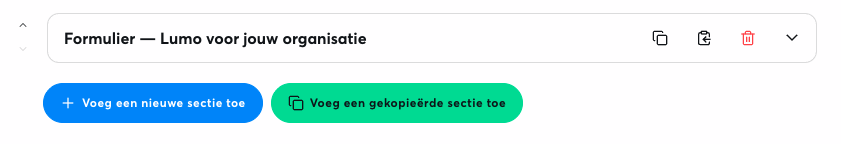
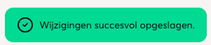

30 september, 2026

Deze release maakt het opbouwen van pagina's sneller en geeft je meer feedback tijdens het werken. Je kunt secties kopiëren in de editor, een standaard alt-tekst instellen voor afbeeldingen en je ontvangt duidelijke meldingen bij successen, waarschuwingen en fouten. Zo weet je altijd of een actie is gelukt, en werk je toegankelijker en efficiënter.

## Secties kopiëren in de editor

Via één van de kopieerknoppen kopieer je een sectie en hergebruik je een bestaande opbouw zonder alles opnieuw in te vullen.

## Standaard alt-tekst voor afbeeldingen

In mediavelden stel je een standaard alt-tekst in die automatisch wordt ingevuld. Dat bespaart tijd en maakt content beter toegankelijk.

<Columns cols={2}>
  <Column>
    ## Nieuw notificatiesysteem

    Na acties zoals opslaan, verwijderen of publiceren krijg je een duidelijke melding bij successen, waarschuwingen en fouten. De stijl van waarschuwingsmeldingen is hierbij ook aangepast.
  </Column>
  <Column>
    
  </Column>
</Columns>
