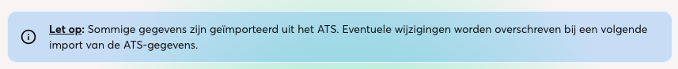

30 oktober, 2026

In oktober introduceren we de eerste AI-functionaliteit in Lumo: een AI-chat waarmee je ook documenten kunt gebruiken. Daarnaast zie je welke content geïmporteerd is en is de mediabibliotheek stabieler geworden. Ook plak je tekst voortaan zonder ongewenste opmaak.

## AI-chat en documenten

Lumo heeft een eerste AI-chat gekregen, met een eigen pagina onder Insights. Je kunt documenten (via ons) uploaden die worden verwerkt zodat de chat er rekening mee kan houden.

## Zichtbaar waar content vandaan komt

Geïmporteerde items tonen een bronlabel in de overzichtstabellen en een infomelding in de editor.

## Plakken als platte tekst

Plak je in een tekstveld, dan wordt alleen tekst ingevoegd, zonder opmaak uit Word, websites of e-mail.
